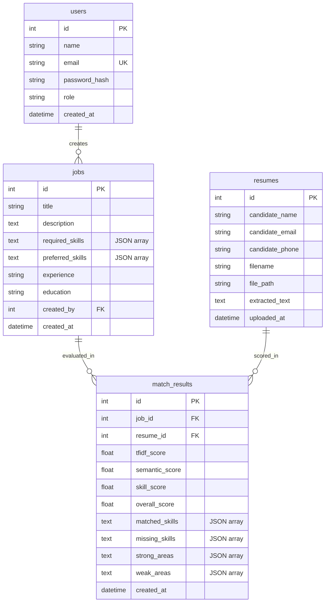

# AI-Powered Resume Screening & Job Matching Platform

An end-to-end, production-ready, interview-grade full-stack web application that automates candidate screening and resume evaluation using multi-layered Natural Language Processing (NLP). Combines lexical keyword analysis (**TF-IDF**), contextual semantic understanding (**Sentence Transformers / all-MiniLM-L6-v2**), and rule-based technical skill taxonomy extraction into an **explainable, ranked candidate score**.

---

## 🌟 Key Features

1. **Multi-Format Resume Ingestion**:
   - Parses `.pdf` (via `pypdf`), `.docx` (via `python-docx`), and `.txt` files.
   - Automatically extracts candidate metadata (name heuristics, email, phone number) with fallback error handling for corrupted or empty documents.

2. **Multi-Layered NLP Matching Engine**:
   - **TF-IDF & Cosine Similarity**: Evaluates exact terminology, token frequencies, and n-grams across job requirements and resume text.
   - **Semantic Contextual AI**: Uses neural embeddings (`all-MiniLM-L6-v2`) to bridge vocabulary discrepancies (e.g., matching *"predictive modeling"* with *"machine learning"*).
   - **Technical Skill Taxonomy**: Extracts exact matched and missing skills against a curated technical catalog (languages, frameworks, databases, cloud, DevOps, AI/ML).

3. **Configurable Weighted Scoring**:
   - Final composite match percentage:
     $$\text{Final Score} = w_{\text{tfidf}} \times \text{TF-IDF} + w_{\text{semantic}} \times \text{Semantic} + w_{\text{skill}} \times \text{Skill}$$
   - Default weights: **30% TF-IDF**, **40% Semantic**, **30% Skill Match**.

4. **Live Interactive AI Match Sandbox (`/live-match`)**:
   - Zero-upload interactive playground: paste arbitrary job descriptions and resume text, select 1-click sample presets, and see real-time vector and skill scoring within milliseconds.
   - Highlights matched keywords directly inside the resume text as visual evidence.

5. **Explainable AI Decision Reports & Evidence Spotlight**:
   - Breaks down overall scores into exact point contributions.
   - Displays matched skills (green badges), missing skills (red badges), strong domain alignments (e.g., Backend, Databases, Cloud), and flagged weaknesses.
   - In-app evidence spotlight highlights matched technical terms within the parsed resume text.

6. **Recruiter Dashboard & Export Tools**:
   - Job posting creation and lifecycle management.
   - Candidate ranking table with real-time filters (minimum score threshold, skill search, candidate name, ascending/descending score sort).
   - Platform analytics: total jobs, total resumes, average match score, top-ranked candidates, and **Job Demand vs. Candidate Skill Distribution charts**.
   - **One-Click CSV Export**: Download candidate ranking reports as structured CSV files.

6. **Authentication & Security**:
   - Recruiter registration and login.
   - Password hashing using Werkzeug salted SHA-256.
   - Stateless JWT session authentication.
   - Strict file validation: extension whitelist, size limit (10MB), and sanitized filenames.

7. **Automated Testing**:
   - Comprehensive test suite (30 test cases) using `pytest`.
   - Unit tests for auth, jobs, parser, NLP matching, and end-to-end API workflows.

---

## 🏗️ Architecture & Data Flow

```
+-------------------------------------------------------------------+
|                           FRONTEND UI                             |
|    (Vanilla HTML5, CSS3 Variables, ES6 JavaScript Fetch API)      |
+---------------------------------+---------------------------------+
                                  |
                           HTTP / REST API
                                  |
+---------------------------------v---------------------------------+
|                         FLASK REST API                            |
|             (Application Factory, Blueprint Routes)               |
+---------------------------------+---------------------------------+
                                  |
+---------------------------------v---------------------------------+
|                       INPUT VALIDATION                            |
|          (Email Regex, Password Length, File Size & Ext)         |
+---------------------------------+---------------------------------+
                                  |
+---------------------------------v---------------------------------+
|                        SERVICE LAYER                              |
|  +---------------------+   +------------------------------------+ |
|  |    ResumeParser     |   |          TextPreprocessor          | |
|  |  (PDF, DOCX, TXT)   |   |   (Lower, Clean, Protect Tech)     | |
|  +---------------------+   +------------------------------------+ |
|  +---------------------+   +------------------------------------+ |
|  |    TFIDFMatcher     |   |          SemanticMatcher           | |
|  | (scikit-learn Vec)  |   |   (Sentence Transformers 384-d)    | |
|  +---------------------+   +------------------------------------+ |
|  +---------------------+   +------------------------------------+ |
|  |    SkillMatcher     |   |          CandidateScorer           | |
|  | (Catalog & Synonyms)|   |     (Weighted Score & Breakdown)   | |
|  +---------------------+   +------------------------------------+ |
+---------------------------------+---------------------------------+
                                  |
+---------------------------------v---------------------------------+
|                     PERSISTENCE / DATABASE                        |
|       (SQLite via Flask-SQLAlchemy ORM + Local Uploads)           |
+-------------------------------------------------------------------+
```

---

## 📂 Project Directory Structure

```
resume-screening-platform/
│
├── app.py                      # Application entrypoint
├── config.py                   # Configuration (Development, Testing, Scoring weights)
├── requirements.txt            # Python dependencies
├── README.md                   # Complete project documentation
├── INTERVIEW_GUIDE.md          # 40+ SDE interview questions & conceptual explanations
├── .gitignore                  # Git ignore rules for database and uploads
├── seed_database.py            # Database seeder script with demo jobs and resumes
├── create_sample_resumes.py    # Generates sample PDF, DOCX, and TXT resumes
│
├── backend/
│   ├── __init__.py             # Flask application factory (create_app)
│   ├── models.py               # SQLAlchemy ORM models (User, Job, Resume, MatchResult)
│   ├── database.py             # Database instance initialization
│   │
│   ├── routes/
│   │   ├── __init__.py         # Route blueprints export
│   │   ├── auth.py             # Auth endpoints (/api/auth/register, /login, /me)
│   │   ├── jobs.py             # Jobs CRUD endpoints (/api/jobs)
│   │   ├── resumes.py          # Resume upload and management (/api/resumes)
│   │   └── candidates.py       # Candidate matching, ranking, and dashboard stats
│   │
│   ├── services/
│   │   ├── __init__.py         # Services export
│   │   ├── resume_parser.py    # Multi-format text & metadata extraction
│   │   ├── text_preprocessor.py# Text cleaning preserving tech terms (C++, C#, etc.)
│   │   ├── tfidf_matcher.py    # TF-IDF keyword vectorizer and cosine similarity
│   │   ├── semantic_matcher.py # Dense sentence embeddings via SentenceTransformers
│   │   ├── skill_matcher.py    # Skill extraction, catalog aliases, domain analysis
│   │   └── scoring.py          # Multi-factor weighted score calculation
│   │
│   └── utils/
│       ├── __init__.py
│       └── validators.py       # JWT tokens, password validation, input sanitation
│
├── frontend/
│   ├── index.html              # Landing page overview
│   ├── login.html              # Recruiter login and registration forms
│   ├── dashboard.html          # Recruiter analytics and top candidates
│   ├── job.html                # Job posting creation and listings
│   ├── candidates.html         # Candidate ranking, filters, and resume upload modal
│   ├── candidate-details.html  # Explainable AI report and score breakdown
│   │
│   ├── css/
│   │   └── style.css           # Clean modern responsive UI stylesheet
│   │
│   └── js/
│       ├── auth.js             # Session state and JWT fetch wrapper
│       ├── dashboard.js        # Analytics loading and candidate cards
│       ├── jobs.js             # Job posting submission and listing
│       └── candidates.js       # Candidate filtering, sorting, and resume upload
│
├── uploads/                    # Local storage for uploaded candidate resumes
├── sample_resumes/             # Pre-generated sample resumes (PDF, DOCX, TXT)
│
├── tests/
│   ├── conftest.py             # Pytest setup and test environment flags
│   ├── test_auth.py            # Unit tests for user registration, login, and JWT
│   ├── test_jobs.py            # Unit tests for job CRUD and validation
│   ├── test_resume_parser.py   # Unit tests for PDF, DOCX, TXT extraction
│   ├── test_matching.py        # Unit tests for TF-IDF, Semantic, Skill matching
│   └── test_api.py             # End-to-end integration tests
│
└── instance/
    └── database.db             # SQLite database file
```

---

## 🛠️ Technology Stack

| Layer | Technologies |
|---|---|
| **Backend** | Python 3.10+, Flask 3.x, Flask-SQLAlchemy, Werkzeug, PyJWT |
| **Database** | SQLite3 (Zero-configuration, ACID compliant) |
| **Document Parsing** | `pypdf` (PDF text extraction), `python-docx` (Word docx), Native UTF-8/fallback (TXT) |
| **NLP & Machine Learning**| `scikit-learn` (TfidfVectorizer, cosine_similarity), `sentence-transformers` (`all-MiniLM-L6-v2`), NumPy, SciPy |
| **Frontend** | Semantic HTML5, CSS3 Custom Properties (Flexbox/Grid), Modern Vanilla ES6 JavaScript |
| **Testing** | `pytest`, Flask Test Client |

---

## 🚀 Installation & Setup

### 1. Clone or Open the Repository
```bash
cd resume-screening-platform
```

### 2. Create and Activate a Virtual Environment (Recommended)
```bash
# Windows
python -m venv venv
venv\Scripts\activate

# macOS / Linux
python3 -m venv venv
source venv/bin/activate
```

### 3. Install Dependencies
```bash
pip install -r requirements.txt
```

### 4. Initialize Database and Seed Sample Data
Run the seeder script to initialize SQLite tables, generate sample resumes, and load demo postings:
```bash
python create_sample_resumes.py
python seed_database.py
```
> **Default Recruiter Credentials:**
> - Email: `recruiter@example.com`
> - Password: `password123`

---

## 💻 Running the Application

### Start the Flask Server
```bash
python app.py
```
The application will launch at:
- **Landing Page**: [http://127.0.0.1:5000/](http://127.0.0.1:5000/)
- **Recruiter Login**: [http://127.0.0.1:5000/login](http://127.0.0.1:5000/login)
- **Recruiter Dashboard**: [http://127.0.0.1:5000/dashboard](http://127.0.0.1:5000/dashboard)
- **Job Management**: [http://127.0.0.1:5000/job](http://127.0.0.1:5000/job)
- **Candidate Screening**: [http://127.0.0.1:5000/candidates](http://127.0.0.1:5000/candidates)

---

## 🧪 Running Automated Tests

Run the complete test suite with verbose output:
```bash
python -m pytest -v
```
To run a specific test file:
```bash
python -m pytest tests/test_matching.py -v
python -m pytest tests/test_api.py -v
```

---

## 📡 REST API Documentation

### 1. Authentication Endpoints

#### `POST /api/auth/register`
Register a new recruiter account.
- **Request Body**:
  ```json
  {
    "name": "Jane Doe",
    "email": "jane@company.com",
    "password": "securePassword123"
  }
  ```
- **Response (201 Created)**:
  ```json
  {
    "success": true,
    "message": "User registered successfully.",
    "token": "eyJhbGciOiJIUzI1NiIsInR5cCI6Ik...",
    "user": {
      "id": 2,
      "name": "Jane Doe",
      "email": "jane@company.com",
      "role": "recruiter"
    }
  }
  ```

#### `POST /api/auth/login`
Authenticate recruiter and obtain JWT token.
- **Request Body**:
  ```json
  {
    "email": "recruiter@example.com",
    "password": "password123"
  }
  ```

---

### 2. Jobs Endpoints

#### `POST /api/jobs`
Create a new job posting.
- **Request Body**:
  ```json
  {
    "title": "Senior Python Backend Developer",
    "description": "Looking for an experienced Python developer to build scalable backend microservices, REST APIs, and database schemas with Flask, SQLAlchemy, PostgreSQL, and Docker.",
    "required_skills": ["Python", "Flask", "SQL", "REST API", "Git"],
    "preferred_skills": ["Docker", "AWS", "PostgreSQL"],
    "experience": "2-4 years",
    "education": "B.Tech in Computer Science / IT"
  }
  ```
- **Response (201 Created)**:
  ```json
  {
    "success": true,
    "job_id": 1,
    "message": "Job created successfully",
    "job": { ... }
  }
  ```

#### `GET /api/jobs`
List all job listings with candidate evaluation counts.

#### `GET /api/jobs/<job_id>`
Get detailed information for a single job posting.

#### `PUT /api/jobs/<job_id>`
Update title, description, or requirements of an existing job.

#### `DELETE /api/jobs/<job_id>`
Delete a job posting and cascade delete all associated candidate evaluations.

---

### 3. Resumes Endpoints

#### `POST /api/resumes/upload`
Upload a candidate resume in `multipart/form-data`.
- **Form Fields**:
  - `file`: Resume file (`.pdf`, `.docx`, `.txt`) - *Required*
  - `candidate_name`: Name override - *Optional*
  - `job_id`: Auto-evaluate against job - *Optional*
- **Response (201 Created)**:
  ```json
  {
    "success": true,
    "message": "Resume uploaded and parsed successfully.",
    "resume": {
      "id": 1,
      "candidate_name": "Alice Walker",
      "candidate_email": "alice.walker@email.com",
      "candidate_phone": "+1-555-019-2834",
      "filename": "alice_backend_developer.txt"
    }
  }
  ```

#### `GET /api/resumes/<resume_id>`
Retrieve a resume and its extracted plaintext.

#### `DELETE /api/resumes/<resume_id>`
Delete a resume from SQLite and unlinks the file from the uploads directory.

---

### 4. Matching & Candidate Ranking Endpoints

#### `POST /api/match/<job_id>/<resume_id>`
Evaluate a single resume against a job requirement.

#### `POST /api/jobs/<job_id>/match-all`
Batch-evaluate all uploaded resumes in the database against a job.

#### `GET /api/jobs/<job_id>/candidates`
Retrieve ranked candidates for a job.
- **Query Parameters**:
  - `min_score`: Filter by minimum score (e.g. `?min_score=60`)
  - `skill`: Filter by matched skill (e.g. `?skill=Python`)
  - `sort`: `desc` (default) or `asc`
  - `search`: Filter by candidate name
- **Response (200 OK)**:
  ```json
  {
    "success": true,
    "total_candidates": 4,
    "candidates": [
      {
        "rank": 1,
        "candidate_name": "Alice Walker",
        "overall_score": 56.27,
        "tfidf_score": 0.1983,
        "semantic_score": 0.5080,
        "skill_score": 1.0000,
        "matched_skills": ["Python", "Flask", "SQL", "REST API", "Git"],
        "missing_skills": [],
        "strong_areas": ["Backend Development (Flask, Python, REST API)", "Databases & Storage (SQL)"],
        "weak_areas": []
      }
    ]
  }
  ```

#### `GET /api/match/<match_id>`
Retrieve complete explainable evaluation details for a specific match.

#### `GET /api/dashboard/stats`
Retrieve system-wide recruiter metrics: total jobs, total candidates, average score, and top 5 ranked candidates.

---

## 🗄️ Database Schema



---

## 🧮 NLP Matching & Scoring Methodology

### 1. TF-IDF Keyword Matching
Term Frequency-Inverse Document Frequency calculates how important a word is to a document in a collection.
- **Term Frequency (TF)**: Frequency of term $t$ in document $d$:
  $$\text{TF}(t, d) = \frac{\text{count}(t, d)}{\text{total words in } d}$$
- **Inverse Document Frequency (IDF)**: Downweights ubiquitous words:
  $$\text{IDF}(t, D) = \log\left(\frac{1 + |D|}{1 + \text{df}(t)}\right) + 1$$
- **Cosine Similarity**: Measures angular orientation between document vectors $\mathbf{A}$ and $\mathbf{B}$:
  $$\text{Cosine Similarity} = \frac{\mathbf{A} \cdot \mathbf{B}}{\|\mathbf{A}\| \|\mathbf{B}\|}$$

### 2. Semantic Contextual Matching
Keyword matching alone misses synonyms. The platform uses **Sentence Transformers** (`all-MiniLM-L6-v2`) to produce dense 384-dimensional vector embeddings:
- Captures context: *"built predictive classification models"* closely aligns with *"machine learning engineer"*.
- Resilient fallback: A sub-word character n-gram dense approximation is included to ensure zero downtime during offline testing or cold-start environments.

### 3. Technical Skill Extraction & Domain Breakdown
- Normalizes aliases: `JS` $\rightarrow$ `JavaScript`, `K8s` $\rightarrow$ `Kubernetes`, `Postgres` $\rightarrow$ `PostgreSQL`.
- Identifies domain clusters:
  - **Backend**: Python, Java, C++, Flask, Django, FastAPI, REST API
  - **Frontend**: JavaScript, TypeScript, React, Vue, HTML, CSS
  - **Databases**: SQL, PostgreSQL, MongoDB, Redis
  - **Cloud/DevOps**: Docker, Kubernetes, AWS, GCP, CI/CD, Git
  - **AI/ML**: Machine Learning, PyTorch, TensorFlow, Scikit-Learn

### 4. Composite Scoring Formula
Configured in `config.py`:
$$\text{Final Score} = 0.30 \times \text{TF-IDF} + 0.40 \times \text{Semantic} + 0.30 \times \text{Skill Match}$$

---

## 🔮 Future Enhancements

1. **OCR Support**: Ingest scanned/image-only resumes using Tesseract OCR.
2. **Asynchronous Processing**: Offload heavy document parsing batches to background Celery workers with Redis.
3. **Automated Interview Scheduling**: Integrate calendar links directly for candidates crossing an 80%+ threshold.
4. **Bias Mitigation**: Provide an anonymized screening toggle hiding candidate name, gender indicators, and graduation years.
